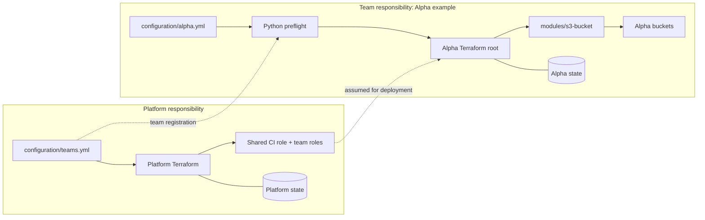

Terraform roots and modules for team-owned S3 buckets and platform-owned IAM in
one AWS account.

# Design Decision
The current design is based of bootstraping team roles from platform while teams create their buckets using their own future pipelines.

The team's access control to buckets is based on bucket policies. After implmenting this approach, it felt tag based access control would be more preferable for this single account setup.


## Repository layout

| Path | Purpose |
| --- | --- |
| `configuration/teams.yml` | Platform-owned team IDs, role names, and operator trust |
| `configuration/{alpha,beta}.yml` | Team bucket declarations |
| `configuration/schemas/team.schema.json` | Schema for team configuration |
| `teams/platform/` | Platform Terraform root: shared CI role and team roles |
| `teams/{alpha,beta}/` | Independent Terraform roots and state for team S3 |
| `modules/` | Reusable Terraform modules; see each module README |
| `scripts/` | Config validation and Terraform runner |

Platform owns IAM. Each team root owns only that team's S3 resources. Team
roots do not read one another's state.

## Responsibility boundaries




## CI and state

The intended CI design has two workflows (GitHub Actions workflows are not yet
installed):

1. The platform workflow responds to `teams/platform/**` and
   `configuration/teams.yml`. It validates the team registry and manages the
   shared CI role and team roles.
2. The team workflow responds to a team's YAML file. It validates that team,
   selects the matching Terraform root, assumes that team's role through the
   shared CI role, and applies that root.

The CI role can assume registered team roles. Team jobs should receive only the
selected team's credentials.

The runner stores local state separately at `state/<root>/terraform.tfstate`
and Terraform metadata under `.terraform-teams/<root>/`.Before enabling applies,
configure persistent remote state, locking, and per-root access controls.

Initialize, plan, apply, or validate a root through the runner:

```sh
python3 scripts/team-terraform.py platform plan
python3 scripts/team-terraform.py alpha plan
python3 scripts/team-terraform.py beta plan
```

Use `apply` to apply a plan.

# Team S3 setup


Install the validator dependencies:

```sh
python3 -m venv .venv
source .venv/bin/activate
python -m pip install -r requirements.txt
```


## Team configuration and preflight

Each team YAML can declare multiple buckets under stable Terraform keys. The
key becomes part of the Terraform resource address, so keep it stable. The
platform registry assigns the team's immutable ID and role name; team pipelines
validate their YAML against the schema and check the ID against this registry.

Run validation without Terraform or AWS credentials:

```sh
python3 scripts/validate_config.py alpha
python3 scripts/validate_config.py beta
python3 scripts/validate_config.py platform
```

The `platform` check validates the registry only. Individual team checks do not
read the other teams' bucket files. The Terraform runner runs the corresponding
preflight before initializing a root.

The platform account, region, environment, tags, and CI inputs are declared in
`teams/platform/variables.tf` and set in `teams/platform/terraform.tfvars`.

## Modules

- [S3 bucket module](modules/s3-bucket/README.md): team YAML input, bucket
  defaults, generated names, and bucket access policy.
- [Account module](modules/account/README.md): team provisioning role,
  operator trust, S3 permissions, and permissions boundary.
- [IAM role module](modules/iam-role/README.md): generic role, boundary, and
  inline-policy implementation.

For this single-account setup, ABAC using a protected `TeamId` tag would better scope team IAM permissions to their own buckets.
This requires enabling S3 ABAC and enforcing ownership tags during creation while preventing unauthorized tag changes.
